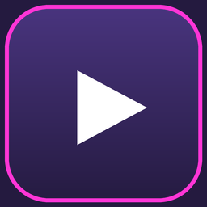

<p align="center">
  
</p>

<h1 align="center">OpenYTPlayer</h1>

<p align="center">Desktop YouTube / YouTube Music player — Python + Tkinter,<br>
extremely customizable: <b>EVERYTHING</b>.</p>

<p align="center">
  Made by <a href="https://github.com/eUROmOUSE888">eUROmOUSE888</a> ·
  <a href="LICENSE">MIT License</a>
</p>

---

## Launch

```bash
pip install -r requirements.txt
python start.py
```

- `python start.py --selftest` → self-tests (client, theme, audio, UI).
  Add `--offline` to skip every network call.
- `python start.py --reset` → resets the customization.
- `python start.py --consola` (or `--show-console`) → keep the console visible.
- On Windows, double-click `start.pyw` (or `start.py`) to open **without a
  console**: the app relaunches itself through `pythonw.exe` when the theme asks
  to hide it.
- Fresh Windows machine? Run `PrerequisitesInstalation.bat` first: it finds (or
  installs via winget) Python 3.11+, upgrades pip, installs `requirements.txt`
  and verifies the imports.

> **Everything personal is ignored by git.** Your accounts, cookies, session,
> playlists and per-song data are created on your machine only — see
> [Privacy](#-privacy-what-never-reaches-github).

## Features

### Playing

- Search **songs and videos**, play / pause / previous / next
- Playback queue, shuffle, **loop: off / all / one**
- Progress bar with click-to-seek, volume, elapsed/total time
- Your account playlists + YouTube Music *Liked* songs
- **Online streaming** through ffmpeg (~3 s, no download), with automatic
  fallback to a local MP3 in `cache/` if the stream fails
- **There are no local song lists or local favourites.** Favourites *are* your
  YouTube Music *Liked* collection, through the API.

### Song rows

**One click plays.** Click anywhere on a row (title, thumbnail, duration or
background) and the song starts immediately — no double-click needed.
**One click on the uploader name** opens that channel's window (never the
album), and a multi-artist song gets one clickable name per artist.

**Drag to reorder.** Press a row and move it: the row follows the pointer and
is dropped in the slot under the cursor. Any song can be dragged from any
position to any position — including across the recommendations separator.
Reordering is **session-only**: no playlist or album is ever modified or
saved.

Everything else is in the **right-click menu**: Play, Play next, Add to queue,
Start radio, YT Music up-next, Related songs, Like/Dislike, Save to a YT
playlist, New YT playlist with this song, Remove from this playlist,
**View album**, **Open channel**, View lyrics, Correct from Last.fm, Song
details, Copy URL, Open in YouTube.

### Playlists that keep playing (loop OFF)

Open a playlist or an album with the loop **off** and a separator bar appears
below the songs with recommended tracks underneath. When the playlist ends,
playback continues with the first recommendation, then the next one. Every
recommendation that starts playing moves **above** the separator, so the
played ones pile up there and the pending ones stay below. The whole list is
loaded into the queue, which is exactly what you see and can drag.

Recommendations live in the session only: they are never added to your
YouTube playlists.

### Channel window

Click a channel to open its own window, with real tabs:

- **Videos / Shorts / Playlists / Home** — from the channel itself
- **Songs** — the real *Top songs* shelf of its YouTube Music catalogue
- **Albums** — the channel's **real releases**, with cover and full tracklist
  (opens inside the app, never a web browser). Channels without a music page
  are looked up by name and filtered by artist, so you get their real albums
  too.

### Last.fm

Link your account in ⚙ Settings → Last.fm (API key + secret, created free at
last.fm/api/account/create; the app never sees your password).

- Scrobbles what you play, using the **edited** title/artist/album
- **Per-song data**: ✏️ edits any song's title / artist / album, saved in
  `config/local-cache.json`
- **"How many times I played it"** on every row (`⟳ N`) and in the player bar
  (`⟳ N plays on Last.fm`), using your edited data. It is your own play count,
  never the global one, and non-latin titles (日本語/中文/한국어) work too. If
  Last.fm doesn't know the track, nothing is shown instead of a wrong number.
- Editing a song re-asks Last.fm, so the count updates immediately

### Customization (🎨 Customize)

The **default look is deliberately boring**: a single neutral grey palette
where every colour has the same R, G and B value (no neon pink, no purple,
no colour emoji — the icons are plain text glyphs). Everything below can be
changed to whatever you like.

- **Background**: solid colour, gradient, **image**, **VIDEO** (mp4/avi/mov/mkv/
  webm, looped, muted), animated GIF
- **Buttons**: size, colours, border, **real shape** (round / square / **your
  own PNG** as the button face)
- **Icons**: every button with an emoji, a letter or **your own image**
- **Text**: colours, sizes, custom `.ttf`/`.otf` font
- **Lists**: background, hover/active colours, thumbnails, transparency, batch size
- **Widgets**: colours of the **search bar**, the **sliders** (progress, volume
  and the ones in this window) and the **right-click menu**
- **Window**: title, transparency, always on top, **own title bar** (no Windows
  frame: minimize/maximize/close with your colours and shapes, draggable,
  remembered size), **app icon**
- **Panels / stickers**: per-section backgrounds, per-menu-button faces,
  floating stickers, movable video panel with configurable FPS
- **Themes**: full looks live in `themes/<name>/`; save, switch and share them
  from the **Themes tab**

## Layout

```
start.py                        <- entry point
start.pyw                       <- console-less launcher for Windows
Iniciar.py / Iniciar.pyw        <- legacy aliases of the entry point
PrerequisitesInstalation.bat    <- fresh-Windows setup
app/config.py                   <- themes (ThemeManager)
app/youtube_client.py           <- YouTube/YouTube Music (InnerTube + yt-dlp)
app/lastfm_client.py            <- scrobbling + your play counts
app/metadata_edits.py           <- per-song data
app/player_engine.py            <- queue/loop/shuffle + pygame audio
app/stream_player.py            <- online ffmpeg streaming
app/ui_main.py                  <- the Tkinter window
app/appicon.py                  <- generates assets/icons/app.ico
assets/icons/                   <- the app icon (shipped)
themes/<name>/                  <- shareable theme packs
config/                         <- YOUR settings and data (git-ignored)
cache/                          <- audio cache, logs (git-ignored)
tests/                          <- real GUI checks
doc.txt                         <- full project documentation
```

## Google account (optional)

The app works **as a guest** (search + public URLs). To reach your own
playlists and Liked songs, link an account in ⚙ Settings:

- **Direct login (easiest)** — opens your real browser on YouTube, *you* log in
  on the real Google page (the app never touches your password) and the cookies
  are imported when you click "I logged in, link it".
- **Permanent OAuth** — create a *Desktop app* OAuth client at
  `console.cloud.google.com` (enable **YouTube Data API v3**), paste the ID and
  secret, authorize once. The token renews itself (`config/oauth.json`).
- **Browser session** — the app reads/keeps the session in its own profile
  folder, or imports it from a closed browser profile.

## Privacy — what never reaches GitHub

`.gitignore` keeps every one of these out of the repository:

| File | What it is |
|------|------------|
| `config/lastfm.json` | Last.fm API key, secret, **session key**, username |
| `config/oauth.json`, `config/oauth_client.json` | Google OAuth credentials |
| `config/browser_login/` | the browser profile holding your Google session |
| `cache/cookies.txt`, `cache/browser.json` | your YouTube session cookies |
| `config/local-cache.json` | your per-song edits (title/artist/album) |
| `config/theme.json` | your colours, fonts, images and window size |
| `cache/` | audio cache and logs |

If you ever commit one of them by accident, **rotate the credential**
(Last.fm: new API key · Google: revoke the OAuth client) — removing the file
from the last commit is not enough.

## Tests

```bash
python -m py_compile app/*.py start.py     # syntax
python start.py --selftest --offline       # self-tests, no network
python start.py --selftest                 # self-tests with network
python tests\gui_check.py                    # real GUI checks (needs network)
```

`tests/README.md` explains what each check covers, and
[`doc.txt`](doc.txt) documents the whole project (architecture, every
feature and the exact final behaviour of the list, the queue and the
recommendations).

## License

[MIT](LICENSE) © 2026 **eUROmOUSE888** — the most open and permissive
license in common use: use, study, modify, redistribute, sell and even
close the source, keeping only the credit line.

YouTube and YouTube Music are trademarks of Google LLC. This project is not
affiliated with or endorsed by Google. It streams content the same way a
browser does; you are responsible for how you use it and for complying with
YouTube's Terms of Service and the copyright of the music you play.